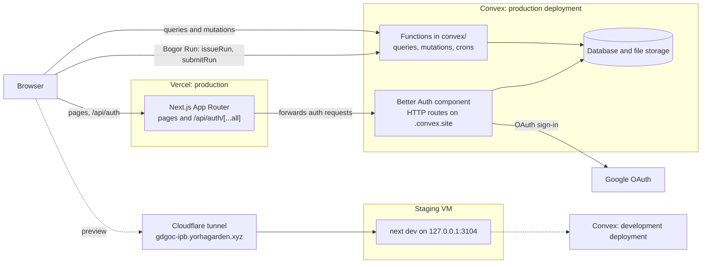

# Architecture

One Next.js app on Vercel, one Convex backend, and Google sign-in through Better Auth. The diagram shows production and the staging preview; the paragraphs below take one node each.

## Browser

Server-rendered pages arrive from Vercel; the landing is prerendered and needs no backend. Signed-in pages (the dashboard, onboarding) and the Bogor Run leaderboard talk to Convex directly over its client, with a Convex token obtained from the auth session. The header reads the session from the same-origin `/api/auth/get-session`.

## Next.js on Vercel

Pages, layouts and the 3D scene live in `src/app/` and `src/components/`. Every push to `main` deploys production; the build runs `pnpm exec convex deploy --cmd 'pnpm build'`, so the backend ships before the frontend that depends on it. The only HTTP API in this repository is the Better Auth route handler at `src/app/api/auth/[...all]/route.ts`, which forwards to the Convex site URL. There is no other REST or GraphQL endpoint to specify.

## Convex functions and database

The queries, mutations and crons in `convex/` are the application API: the frontend calls them by name through the generated `api` object, and each checks access itself (`convex/access.ts`). `convex/schema.ts` defines every table, and file uploads use Convex storage. Tests run them against `convex-test` with no deployment.

## Better Auth with Google OAuth

`convex/auth.ts` configures Better Auth as a Convex component, and `convex/http.ts` registers its routes on the deployment's `.convex.site` URL. Google is the only sign-in method. The secrets (`BETTER_AUTH_SECRET`, `GOOGLE_CLIENT_ID`, `GOOGLE_CLIENT_SECRET`) and the one trusted origin (`SITE_URL`) are set on each Convex deployment, never on Vercel. `gdgocipb.com` redirects to `www.gdgocipb.com` so sign-in always runs on that origin.

## Bogor Run replay

The game runs in the browser on the fixed-tick engine in `src/lib/bogor-run/`. Before a signed-in run, `bogorRun.issueRun` returns a server-signed seed token; when the run ends, the client sends `bogorRun.submitRun` its recorded inputs and score. The mutation replays the inputs on the same engine with that seed and saves the score only if the replay matches. The tokens are signed with a key derived from `BETTER_AUTH_SECRET`; without it the game plays unranked.

## Staging VM and Cloudflare tunnel

A preview runs `next dev` on another VM against the Convex development deployment, reached at `gdgoc-ipb.yorhagarden.xyz` through a Cloudflare tunnel. `DEV_ALLOWED_ORIGINS` lets that hostname reach the dev server, and the tunnel's origin is set as `NEXT_PUBLIC_SITE_URL` and as `SITE_URL` on the development deployment, with its callback registered on the Google OAuth client. Vercel builds production only, so this is the place to check a branch before it merges.
