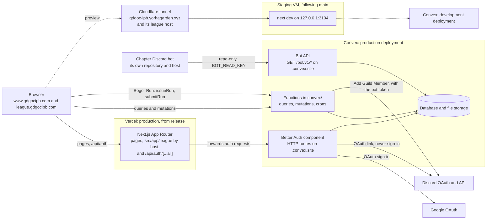

# Architecture

One Next.js app on Vercel, one Convex backend, and Google sign-in through Better Auth. The app answers two hosts: the chapter site and Tech League's own (#179). The diagram shows production and the staging preview; the paragraphs below take one node each.

## Browser

Server-rendered pages arrive from Vercel; the landing is prerendered and needs no backend. Signed-in pages (the dashboard, onboarding) and the Bogor Run leaderboard talk to Convex directly over its client, with a Convex token obtained from the auth session. They read the session when they load and when another tab signs out, not every time the tab comes back into view, because each read is a Convex function call (#269). The header reads the session from the same-origin `/api/auth/get-session`.

## Next.js on Vercel

Pages, layouts and the 3D scene live in `src/app/` and `src/components/`. Vercel deploys production from the `release` branch, which takes only release pull requests from `main` ([ADR 0006](decisions/0006-production-deploys-from-release.md)); pushes to `main` do not build. The build runs `pnpm exec convex deploy --cmd 'pnpm build'`, so the backend ships before the frontend that depends on it. The only HTTP route in the Next.js app is the Better Auth route handler at `src/app/api/auth/[...all]/route.ts`, which forwards to the Convex site URL. The one other HTTP API is the bot's, on Convex (see [Bot API](#bot-api)).

Both hosts reach the same deployment ([ADR 0008](decisions/0008-league-subdomain-one-app-shared-login.md)). When `NEXT_PUBLIC_LEAGUE_URL` is set, a `beforeFiles` rewrite in `next.config.ts` serves the league host's pages from `src/app/league/`, matched on the `Host` header; `/api`, `/_next` and static files are shared. `src/proxy.ts` runs first: on the league host it redirects `/dashboard`, `/onboarding` and `/k/*` to the main host, and on either host it redirects `/league/*` and `/program/tech-league` (301) to the league host. Unset, neither does anything and `/league` is a `noindex` preview on the main host.

## Convex functions and database

The queries, mutations and crons in `convex/` are the application API: the frontend calls them by name through the generated `api` object, and each checks access itself (`convex/access.ts`). Actions call outside services: Discord's REST API, only through `convex/discordApi.ts`, to add a linked member to the chapter server. `convex/schema.ts` defines every table, and file uploads use Convex storage. Tests run them against `convex-test` with no deployment.

## Better Auth with Google OAuth

`convex/auth.ts` configures Better Auth as a Convex component, and `convex/http.ts` registers its routes on the deployment's `.convex.site` URL. Google is the only sign-in method. A signed-in member can link a Discord account, which never signs anyone in; its callback also stays on `SITE_URL`, and the four `DISCORD_*` values live on the Convex deployment ([ADR 0009](decisions/0009-discord-linked-never-sign-in.md), [Discord](DISCORD.md)). The secrets (`BETTER_AUTH_SECRET`, `GOOGLE_CLIENT_ID`, `GOOGLE_CLIENT_SECRET`) and the trusted origins (`SITE_URL`, and `LEAGUE_URL` for Tech League) are set on each Convex deployment, never on Vercel. `gdgocipb.com` redirects to `www.gdgocipb.com` so Google's callback always runs on that origin.

## Bot API

The chapter's Discord bot runs from its own repository and host and reads the site through a read-only HTTP API: Convex HTTP actions under `/bot/v1/` on the deployment's `.convex.site` URL, registered in `convex/http.ts` and served by `convex/botApi.ts`. It sends `BOT_READ_KEY`, set on each Convex deployment and on the bot's host, as a bearer token; without that value every route answers 503. Responses are mapped field by field from an allowlist and never carry members' data. Paths, fields and limits are in [Bot API](BOT_API.md).

One login covers both hosts. With `AUTH_COOKIE_DOMAIN` set, Better Auth writes its cookies, the OAuth state cookie included, on that parent domain, so a session started on either host is sent to both and signing out of one clears both. Sign-in started on the league asks Google to return to `SITE_URL` as usual, with an absolute league `callbackURL` that Better Auth accepts because `LEAGUE_URL` is trusted, and the callback then redirects there. The auth route also expires the host-only twin of each cookie it sets on the parent domain, left from before the change. Testing this locally needs two hosts under one parent domain, such as `www.lvh.me` and `league.lvh.me`; `localhost` subdomains cannot share a cookie.

## Bogor Run replay

The game runs in the browser on the fixed-tick engine in `src/lib/bogor-run/`. Before a signed-in run, `bogorRun.issueRun` returns a server-signed seed token; when the run ends, the client sends `bogorRun.submitRun` its recorded inputs and score. The mutation replays the inputs on the same engine with that seed and saves the score only if the replay matches. The tokens are signed with a key derived from `BETTER_AUTH_SECRET`; without it the game plays unranked. Tickets come from a Convex client that never carries the player's token, because that token expires after 15 minutes and Convex refuses calls that send it expired (#226); saves and the board use the signed-in client, whose token is renewed before each save and board load.

A paused run is kept in the tab's `sessionStorage` (seed, token, input log and tick) and rebuilt with `resumeRun` after a reload, so it can still end and be saved on its own ticket. The local REKOR counts only runs that ended, the same runs the leaderboard can receive (#223).

## Staging VM and Cloudflare tunnel

A preview runs `next dev` on another VM against the Convex development deployment, reached at `gdgoc-ipb.yorhagarden.xyz` through a Cloudflare tunnel, and at a second tunnel host for the league once `NEXT_PUBLIC_LEAGUE_URL`, `LEAGUE_URL` and `AUTH_COOKIE_DOMAIN` are set for it. `DEV_ALLOWED_ORIGINS` lets that hostname reach the dev server, and the tunnel's origin is set as `NEXT_PUBLIC_SITE_URL` and as `SITE_URL` on the development deployment, with its callback registered on the Google OAuth client. The VM follows `main`, so it previews the next release; Vercel builds production only. It is also the place to check a branch before it merges.
